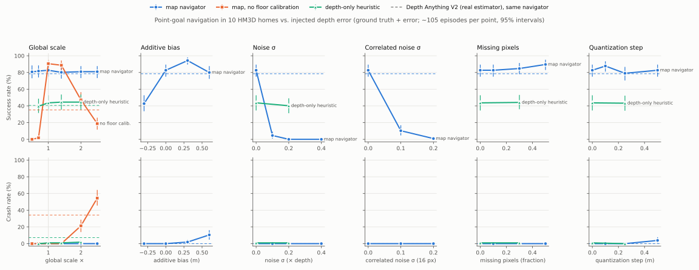

# Deliverable A: how depth error becomes navigation error

Point-goal navigation in Habitat-Sim on the 10 HM3D minival homes (set A: 120 episodes, seed 3003, fixed and
committed before any run). Every run uses the same latency-honest loop and crash rule; only the depth the navigator is
given changes: simulator ground truth (the spec's depth-sensor baseline), ground truth with one controlled error, or
Depth Anything V2. Runner `tools/run_pointnav_eval.py`, sweep `scripts/run_depth_error_sweep.sh`, tables
`tools/summarize_pointnav.py`, figure `tools/plot_depth_error.py`. Results: `results/runs/pointnav/A/summary.json`.

## Setup

- **Navigators.** `map`: map-free occupancy mapping from depth + Dijkstra + carrot + reactive safety layer, with
  floor-plane scale self-calibration (`FloorScale`: the camera height is known, so floor pixels have a known depth).
  `map_nofs`: the same with calibration off. `heuristic`: the depth-only potential field (milestone #7), with the same
  calibration. No VLM in this study.
- **Success**: within 0.36 m of the goal before the time budget (30 s + 3× geodesic at 0.35 m/s). **Crash**: driving
  forward with < 0.3 m true clearance ahead (ends the run).
- **Voiding.** A run that met a hole in the scanned mesh (ground-truth depth ≈ 0 ahead) is voided on its own: 435 of
  4,320 runs, concentrated in 24 episodes whose paths pass real mesh holes. Cells keep 104–112 episodes; paired tests
  use only pairs where both runs are valid.
- **Statistics**: 95% bootstrap intervals; vs ground truth, exact McNemar on paired success (losses/gains, p).

## Results (map navigator unless stated)

| Depth given | n | Success % [95%] | SPL | Crash % | Depth AbsRel | vs GT (−/+, p) |
|---|---|---|---|---|---|---|
| Ground truth | 104 | 83 [75, 89] | 0.77 | 0 | 0.00 | ref |
| **Depth Anything V2** | 107 | **79 [71, 86]** | 0.72 | 0 | 1.39 | −10/+8, p = 0.82 |
| GT × 0.5 … × 2.5 (scale) | 104–106 | 80–82 | 0.74–0.76 | 0 | 0.30–1.50 | p ≥ 0.5 at every level |
| GT − 0.3 m (too near) | 110 | 43 [34, 53] | 0.39 | 0 | 0.23 | −38/+0, p < 1e-11 |
| GT + 0.3 m (too far) | 105 | 94 [90, 98] | 0.87 | 2 | 0.22 | −0/+12, p = 0.0005 |
| GT + 0.6 m | 105 | 80 [72, 88] | 0.73 | 10 | 0.45 | −11/+8, p = 0.65 |
| GT + noise σ = 0.1 × depth | 109 | **5 [1, 9]** | 0.04 | 0 | 0.08 | −79/+0, p < 1e-23 |
| GT + noise σ = 0.2 / 0.4 | 110–112 | 0 | 0.00 | 0 | 0.16 / 0.32 | p < 1e-25 |
| GT + correlated noise σ = 0.1 / 0.2 (16 px) | 107–112 | 10 / 1 | 0.10 / 0.01 | 0 | 0.08 / 0.16 | p < 1e-21 |
| GT, 10–50% pixels missing | 104–106 | 83–90 | 0.77–0.84 | 0 | (holes) | p ≥ 0.09 |
| GT quantized to 0.1 / 0.25 / 0.5 m | 104–106 | 88 / 79 / 83 | 0.73–0.80 | 0–4 | 0.02–0.10 | p ≥ 0.07 |
| *No floor calibration:* ground truth | 106 | 91 [85, 95] | 0.85 | 0 | 0.00 | −3/+11, p = 0.06 |
| *No floor calibration:* Depth Anything V2 | 111 | 35 [26, 44] | 0.32 | **34** | 1.42 | −52/+5, p < 1e-10 |
| *No floor calibration:* GT × 0.5 / × 0.7 | 110–111 | 0 / 2 | ~0 | 0 | 0.50 / 0.30 | p < 1e-24 |
| *No floor calibration:* GT × 1.4 | 106 | 89 | 0.80 | 0 | 0.40 | p = 0.17 |
| *No floor calibration:* GT × 2.0 / × 2.5 | 108–112 | 47 / 19 | 0.42 / 0.16 | **21 / 54** | 1.00 / 1.50 | p < 1e-5 |
| Heuristic: GT / DA / noise 0.2 / scale 0.7–2.0 | 110–112 | 44 / 41 / 40 / 40–45 | 0.37–0.42 | 0–7 | | (heuristic ceiling ~44%) |

## What it says

1. **The real estimator costs this navigator almost nothing.** Depth Anything V2 reaches 79% against ground truth's
   83%, not a detectable difference at n ≈ 105 (p = 0.82), despite a mean AbsRel of 1.39 (it reads HM3D ~2× too far).
2. **Because its error is almost all global scale, and the floor calibration removes scale.** With calibration, scale
   errors from 0.5× to 2.5× change nothing (80–82%). Without it the same errors are catastrophic in both
   directions: too near (×0.5, ×0.7) everything looks blocked and the robot never arrives (0–2%, all timeouts); too far
   (×2, ×2.5) it crashes (21%, 54%). Uncalibrated Depth Anything: 35% success, 34% crashes. So the claim that
   navigation tolerates monocular scale error (LG-VLN, see `docs/lit_review/positioning.md`) holds only with a scale
   correction. It is the calibration, not the estimator, that makes monocular depth usable here.
3. **Error magnitude does not predict navigation error; error type does.** Zero-mean noise with σ = 10% of depth (AbsRel
   0.08, RMSE 0.18 m) collapses the map navigator to 5%, while a 2.5× scale error (AbsRel 1.50, RMSE 3.3 m) costs
   nothing. A single depth-RMSE axis would put these in the wrong order. This is the core of hypothesis H-A, though
   the damaging type here is noise, not (yet) the structured reflective error the hypothesis names.
4. **The noise collapse is an interaction with the map representation.** The mapper takes the *nearest* point of
   obstacle height in each image column; on floor pixels, depth noise moves the computed height across the 0.2 m
   obstacle threshold, so zero-mean noise becomes systematic phantom obstacles. Offline on saved frames, σ = 0.1 makes
   13–36% of columns read ≥ 0.5 m nearer than truth (σ = 0.2: 71–72%). The depth-only heuristic, which uses no height
   filter, is barely affected (40% vs 44%). Robust per-column statistics are the obvious remedy; that ablation is not
   run yet.
5. **Error direction matters: too near costs more than too far, until too far starts crashing.** −0.3 m halves success
   (43%: the robot treats doorways as blocked); +0.3 m *improves* it (94%: it commits to narrow gaps), and +0.6 m brings
   crashes (10%).
6. **Missing data and quantization are harmless** for this mapper (missing pixels are skipped, and a column still finds
   its nearest valid point); 50% holes slightly *help* (fewer spurious obstacles).
7. **The planner, not perception, sets the ceiling.** Even with ground truth the map navigator succeeds 83% of the
   time (91% without the floor calibration, whose own estimates are noisy on beds and tables: p = 0.06); the reactive
   heuristic stays near 44% under every error. Perception error is measured against these ceilings.

## Limits

- One navigator family (map-based + reactive), 10 minival homes, simulated depth error on ground truth. The noise
  model (independent or 16-px-correlated Gaussian ∝ depth) is harsher than the estimator's spatially smooth error.
- HM3D lighting and mirrors are baked; reflective and textureless structured errors are measured on set S (below,
  pending).
- Scan holes remove ~10% of runs; voiding is per run, so cells differ slightly in which episodes they keep.

## Structured errors (set S): pending

Stage 4 of the sweep: reflective factor ×1.5/2/3 on mirror/glass pixels, flattened texture, and the scale-aligned
swaps (estimator error on reflective/textureless pixels only, or fixed there). This is the test of H-A's structured half.
